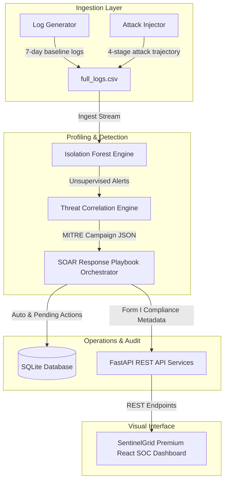

# SentinelGrid — System Architecture & Implementation

This document details the system architecture of the SentinelGrid SOAR & SIEM platform, its data flow, core component details, and environment verification guide.

---

## 🏗️ System Architecture



---

## 📂 Component Directory Breakdown

* **`backend/data_gen/generate_logs.py`**: Simulates 7 days of normal baseline log behavior for 50 users (expected IP locations, working hour windows, and access patterns).
* **`backend/data_gen/inject_attack.py`**: Injects a 4-stage MITRE-mapped attack chain targeted at credentials of user `dr_sharma`.
* **`backend/detection/anomaly_engine.py`**: Trains the `IsolationForest` model on baseline profiles and generates Explainable AI (XAI) storytelling explanations for flagged deviations.
* **`backend/detection/correlation.py`**: Groups single alerts into multi-stage attack campaigns using username tracking.
* **`backend/response/orchestrator.py`**: Triggers SOAR mitigation playbooks. Saves execution history into a local SQLite database (`sentinelgrid.db`) and handles manual approval gates.
* **`backend/api/main.py`**: Exposes FastAPI endpoints for alerts, campaigns, audit logs, containment actions, and CERT-In Form I compliance reports.
* **`frontend/src/App.jsx`**: Premium visual interface with a dark-cyber aesthetic, animated threat radar, interactive charts, device quarantine registers, and compliance report downloads.

---

## 🚀 Environment Verification & Setup

Follow these steps to run the complete environment locally for judging or evaluation.

### Prerequisites
Make sure **Python 3** and **Node.js** are installed.

### 1. Backend Setup & Startup
Navigate to the `backend` directory, install requirements, and start the FastAPI uvicorn server:
```bash
# Navigate to backend folder
cd backend

# Install dependencies
pip install -r requirements.txt

# Start the API server
py api/main.py
```
*The API server will run at: `http://127.0.0.1:8000`*

### 2. Frontend Setup & Startup
Navigate to the `frontend` directory, install node modules, and start the Vite dev server:
```bash
# Navigate to frontend folder
cd ../frontend

# Install dependencies
npm install

# Start development server
npm run dev
```
*The React Dashboard will open at: [http://localhost:5173](http://localhost:5173)*

### 3. Automated Pipeline Verification
To verify the entire detection, mapping, and orchestration pipeline runs successfully, run the automated integration test script in a separate shell:
```bash
# From workspace root
py backend/test_api.py
```
This script will:
1. Run the simulation (logs -> attack -> detection -> correlation -> SOAR playbooks).
2. Query the alerts feed.
3. Validate campaign mapping.
4. Execute human-in-the-loop playbook approval.
5. Generate and check the compliance report.
