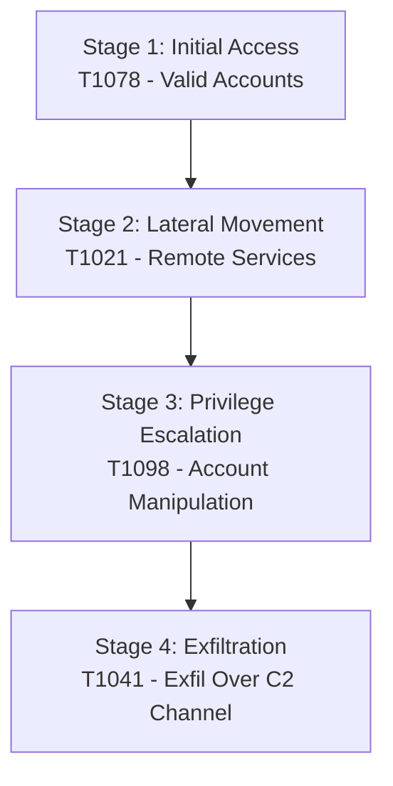

# SentinelGrid — Detection Capabilities & Attack Scenarios

This document explains the built-in attack scenarios simulated within the SentinelGrid environment, how they map to the **MITRE ATT&CK** framework, and the detection capabilities of our Machine Learning profiling engine.

---

## 🛡️ Built-in Attack Campaign: Target User `dr_sharma`

SentinelGrid includes a pre-packaged, multi-stage cyber campaign that simulates a realistic threat actor compromising credentials, moving laterally, escalating privileges, and exfiltrating database backups.

### Attack Path Lifecycle (4-Stage Chain)

#### 📍 Stage 1: Initial Access / Defense Evasion
* **MITRE ATT&CK Technique**: [T1078 — Valid Accounts](https://attack.mitre.org/techniques/T1078/)
* **Simulation Event**: At **2:15 AM**, a successful login is recorded for standard user `dr_sharma` originating from **Moscow, Russia** (IP: `95.213.255.1`).
* **Why it's anomalous**: The baseline profile of `dr_sharma` shows they only connect from Indian cities (Chennai, Mumbai) during normal working hours (9:00 AM – 6:00 PM).

#### 📍 Stage 2: Lateral Movement
* **MITRE ATT&CK Technique**: [T1021 — Remote Services](https://attack.mitre.org/techniques/T1021/)
* **Simulation Event**: At **2:45 AM**, the session accesses **`backup_server`** and transfers 15.5 MB of data.
* **Why it's anomalous**: `dr_sharma` has never accessed `backup_server` during the baseline period. They typically access `hr_portal` and `mail_server`.

#### 📍 Stage 3: Privilege Escalation
* **MITRE ATT&CK Technique**: [T1098 — Account Manipulation](https://attack.mitre.org/techniques/T1098/)
* **Simulation Event**: At **3:10 AM**, the session triggers a privilege change event on the **`domain_controller`**, elevating the profile from `user` to `admin` level.
* **Why it's anomalous**: Privilege level elevations are high-risk actions. There is no active IT change ticket or administrative work window scheduled for this account.

#### 📍 Stage 4: Exfiltration
* **MITRE ATT&CK Technique**: [T1041 — Exfiltration Over C2 Channel](https://attack.mitre.org/techniques/T1041/)
* **Simulation Event**: At **3:50 AM**, the administrator-level session transfers **4,500 MB (4.5 GB)** of database logs to an external IP (`external_exfil_ip`).
* **Why it's anomalous**: A 4.5 GB outbound payload is **300 times larger** than the user's historical maximum payload baseline (15 MB).

---

## 🧠 Machine Learning Detection Engine

### Unsupervised Anomaly Profiling
SentinelGrid uses a **Security Profiler & Isolation Forest** model (implemented in `scikit-learn`) to detect deviations without relying on signatures. It builds a baseline for every user using historical log streams.

For each incoming log record, the engine extracts a 5-dimensional feature deviation vector:
1. **Geographical Deviation**: $1$ if the country is unseen for this user, else $0$.
2. **Time Deviation**: Distance in hours from the user's working hours window.
3. **Host Access Deviation**: $1$ if the target server has never been accessed by this user, else $0$.
4. **Data Volume Deviation**: Payload size minus the user's historical maximum baseline.
5. **Privilege Modification Deviation**: $1$ if account escalation occurs, else $0$.

### Explainable AI (XAI) Reason Compiler
When the Isolation Forest flags an event, the Explainable AI layer translates the vector differences into plain-English storytelling summaries. This allows non-technical stakeholders (such as judges, compliance officers, and operations teams) to immediately understand what caused the alert.
