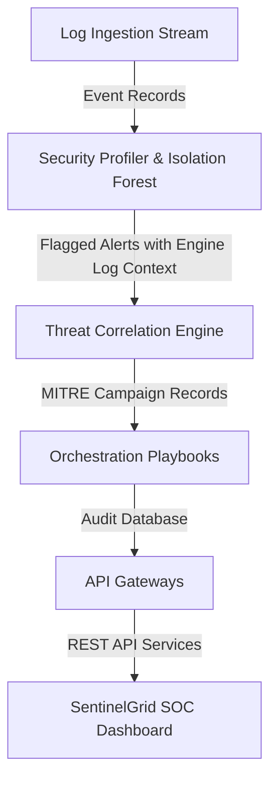

# SentinelGrid Enterprise SIEM & SOAR Guide

SentinelGrid is an enterprise-grade security monitoring and automated incident response platform (SIEM + SOAR) that baselines authentication models, correlates threat trajectories, maps behaviors to MITRE ATT&CK techniques, and triggers playbooks for mitigation.

---

## 🏗️ System Architecture



---

## 🌟 Advanced Platform Capabilities

### 1. Ingest Analysis Engine & Explainable AI (XAI)
The security profiling layer fits an `IsolationForest` model to baseline profiles. When anomalies are detected, the profiler compiles contextual reasoning details explaining the specific deviations (e.g., *Origin Location: Russia (expected India)*).

### 2. Device Inventory & Dynamic Blast Radius
Operator isolation playbooks interact directly with the asset register. Quarantining an compromised destination endpoint (e.g., `external_exfil_ip`) dynamically updates the **Device Inventory** host health cards and shuts down affected backup sync routes in real-time.

### 3. Integrated Security Feeds
Supports active integrations with external telemetry layers:
- **CrowdStrike Falcon Link** (Endpoint host telemetry)
- **Cloudflare WAF Ingest** (Border firewall web traffic)
- **AWS GuardDuty Connector** (Cloud audit logs)

### 4. CERT-In Incident Reports (Form I)
The compliance generator consolidates incident timelines and remediation logs, exporting print-ready notification sheets in accordance with the Indian Computer Emergency Response Team (CERT-In) guidelines.

---

## 📂 Project Directory Structure

```
E:\cyber-resilience/
├── backend/
│   ├── data/                 # Raw logs, alerts, SQLite DB
│   ├── data_gen/
│   │   ├── generate_logs.py  # Generates 7-day normal baseline logs
│   │   └── inject_attack.py  # Injects the 4-stage attack sequence
│   ├── detection/
│   │   ├── anomaly_engine.py # IsolationForest to detect alerts + XAI
│   │   ├── attck_mapper.py   # MITRE ATT&CK mapping
│   │   └── correlation.py    # Correlates alerts into a multi-stage campaign
│   ├── response/
│   │   └── orchestrator.py   # Playbooks, SQLite logs, Auto vs approval gate
│   ├── api/
│   │   └── main.py           # FastAPI endpoints
│   ├── test_api.py           # Automated integration test script
│   └── requirements.txt      # Python dependencies
└── frontend/                 # React (Vite) application
```

---

## 🚀 Launching the Platform

### 1. Start the Backend API Server
Navigate to the backend directory and launch the FastAPI web server using python launcher:
```bash
py E:\cyber-resilience\backend\api\main.py
```
*API is hosted on: `http://localhost:8000`*
*Interactive API docs: `http://localhost:8000/docs`*

### 2. Start the Frontend React Dashboard
Navigate to the frontend directory and start the Vite development server:
```bash
cd E:\cyber-resilience\frontend
npm run dev
```
*SOC Dashboard is hosted on: `http://localhost:5173`*

### 5. Frontend Production & Vercel Deployment
- Run the production compiler: `npm run build` in the `frontend` folder.
- Deploy the compiled static HTML/JS build on an **NGINX web server** or an **S3 + CloudFront CDN** for high availability.

#### Deploying Frontend on Vercel:
1. Connect your GitHub repository to your **Vercel Dashboard**.
2. In the project setup, set the **Root Directory** to `frontend`.
3. Vercel will automatically detect the Vite config. Leave build commands as default (`npm run build`, output directory `dist`).
4. Click **Deploy**. The `vercel.json` file inside the `frontend` directory handles single-page routing redirects automatically.

---

## 🛡️ Validation & Operational Flow

1. Open `http://localhost:5173` in your web browser.
2. Click **Run Threat Assessment** on the top right. This clears the historical audits, ingests external log packets, and updates the ML baseline.
3. Select **Alert Feed** to inspect the identified anomalies along with the **Engine Analysis** reasons.
4. Click **Correlated Campaigns** to trace the chronological multi-stage attack trajectory.
5. Open **Playbooks & Orchestrations** to view executed actions, and click **Execute Action** to approve pending containment playbooks.
6. Open **Device Inventory** to see nodes transitively go offline once you isolate compromised hosts.
7. Navigate to **Compliance Reporting** to download the CERT-In notification report.
